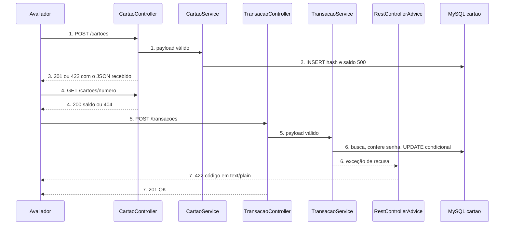
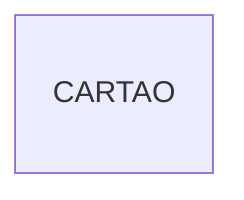

# Mini autorizador

**Approved**: 2026-11-16 - user: "Aprovo o plano"

## Problem

O processo seletivo da VR Benefícios pede um mini autorizador de vale refeição e alimentação, e hoje
não existe aplicação: o avaliador vai subir o `docker/docker-compose.yml`, rodar a aplicação e
executar um roteiro fixo (criar cartão, ler saldo, transacionar até `SALDO_INSUFICIENTE`, senha
inválida, cartão inexistente). Qualquer divergência de status ou corpo do contrato reprova no roteiro;
estilo, testes e a resposta à concorrência entre instâncias são o que a entrevista discute. A fonte não
dá prazo nem volume.

Quando isto ficar pronto, o avaliador roda o roteiro do `docs/desafio.md` contra a aplicação e cada
passo devolve exatamente o status e o corpo do contrato, inclusive com duas instâncias debitando o
mesmo cartão ao mesmo tempo.

## Shape

Nada a reusar: repo novo; o `docker/docker-compose.yml` do desafio é a única peça existente e o MySQL
dele é usado como está. As regras que mudam o resultado (existência, senha, saldo, validação de
entrada) ficam no domínio e no service, alcançados por teste de unidade; o débito atômico fica no SQL
do repository (Spring JDBC, `JdbcClient`, sem JPA), alcançado por teste de integração com Testcontainers `mysql:5.7`.

1. `POST /cartoes` -> `CartaoController` (new) - valida o payload (400) e entrega a `CartaoService`
2. `CartaoService` (new) - gera o hash BCrypt da senha e insere `Cartao` com saldo 500.00 (door 1) por `INSERT` explícito; `DuplicateKeyException` (erro 1062) -> `CartaoJaExiste`
3. out: 201 ou 422 com o JSON recebido `{numeroCartao, senha}`
4. `GET /cartoes/{numeroCartao}` -> `CartaoController` - lê `Cartao`; out: 200 com o saldo como número JSON, ou 404 sem corpo
5. `POST /transacoes` -> `TransacaoController` (new) - valida o payload (400) e entrega a `TransacaoService`
6. `TransacaoService` (new) - busca `Cartao` (ausente -> `CARTAO_INEXISTENTE`), confere a senha com BCrypt fora de transação (`SENHA_INVALIDA`), executa o débito condicional em auto-commit (door 2); 0 linhas -> `SALDO_INSUFICIENTE`
7. out: 201 `OK`, ou 422 com o código de recusa em `text/plain`, mapeado por `RestControllerAdvice` (new)

**Changes underneath**

| Front | What changes |
| --- | --- |
| domain | nada existe; `Cartao` nasce aqui |
| stored data | tabela nova, nada a migrar |
| readers | só o próprio `GET /cartoes/{numeroCartao}` |

New: `CARTAO` (sem relações; transação não é persistida). One-way constraints: `numero` chave
primária (door 1).

## Surface

| Route | In | Out | Status | Who |
| --- | --- | --- | --- | --- |
| `POST /cartoes` | JSON `numeroCartao`, `senha` | JSON `{senha, numeroCartao}` igual ao recebido | 201, 422 (já existe), 400 (payload inválido) | anyone |
| `GET /cartoes/{numeroCartao}` | path `numeroCartao` | saldo como número JSON, ex. `495.15` | 200, 404 sem corpo | anyone |
| `POST /transacoes` | JSON `numeroCartao`, `senhaCartao`, `valor` | `text/plain` `OK` ou `SALDO_INSUFICIENTE` / `SENHA_INVALIDA` / `CARTAO_INEXISTENTE` | 201, 422, 400 (payload inválido) | anyone |

## Landing

| One-way door | Literal shape | Alternative rejected |
| --- | --- | --- |
| 1. Tabela `cartao` (`schema.sql`, `CREATE TABLE IF NOT EXISTS`, `spring.sql.init.mode=always`) | `numero VARCHAR(19) PRIMARY KEY, senha_hash VARCHAR(60) NOT NULL, saldo DECIMAL(19,2) NOT NULL` | Flyway (suporte ao MySQL 5.7 na versão gratuita não confirmado, uma tabela só); `ddl-auto` (Hibernate decide o schema) |
| 2. Débito atômico | `UPDATE cartao SET saldo = saldo - :valor WHERE numero = :numero AND saldo >= :valor`, aprova só com 1 linha afetada | `SELECT ... FOR UPDATE` (segura lock de linha na transação); `@Version` (conflito vira erro ou retry) |
| 3. Contrato HTTP | os três endpoints da Surface, literais do `docs/desafio.md` | nenhuma: o avaliador consome |
| 4. Dependências | Spring Boot 4.1.x (Java 17), `spring-boot-starter-jdbc`, `spring-security-crypto` (BCrypt), Testcontainers 2.0.2 ou acima, `mysql-connector-j` fixado na última 8.0.x | Boot 3.5 (suporte OSS encerrado em 30/06/2026); JPA/Hibernate 6 e 7 (mínimo MySQL 8.0, aviso HHH000511); Spring Security completo (filtros e auth que ninguém pediu); H2 (não reproduz o lock do MySQL); Connector/J 8.4+, 9.x e 26.x (só MySQL 8.0 ou acima, pelas notas oficiais); Testcontainers abaixo de 1.21.4 ou 2.0.0-2.0.1 (Docker 29 recusa a API 1.32) |

- Nothing else in this change is hard to reverse

## Criteria

### S1: Criar cartão e consultar saldo (P1)

O avaliador cria um cartão e vê o saldo inicial.

**Acceptance Criteria**

1. WHEN `POST /cartoes` recebe `{"numeroCartao":"6549873025634501","senha":"1234"}` de um número novo THEN the system SHALL responder 201 com o JSON `{"senha":"1234","numeroCartao":"6549873025634501"}`, campos nessa ordem
2. WHEN um cartão é criado THEN the system SHALL gravá-lo com saldo `500.00`
3. IF `POST /cartoes` recebe um `numeroCartao` já existente THEN the system SHALL responder 422 com o JSON recebido e manter saldo e senha do cartão original
   - segundo POST com senha diferente → 422, e a senha original continua autorizando
4. IF dois `POST /cartoes` com o mesmo número chegam ao mesmo tempo THEN the system SHALL criar um cartão só, um 201 e um 422
5. WHEN `GET /cartoes/6549873025634501` de um cartão existente THEN the system SHALL responder 200 com o saldo como número JSON com duas casas
   - recém-criado → `500.00`; depois de transação de `4.85` → `495.15`
6. IF `GET /cartoes/{numeroCartao}` de um número inexistente THEN the system SHALL responder 404 sem corpo
   - número de 16 dígitos não cadastrado → 404; `abc` → 404 (GET não valida formato)
7. The system SHALL guardar a senha só como hash BCrypt; a coluna `senha_hash` nunca contém a senha recebida

### S2: Autorizar transação (P1)

O avaliador transaciona até o saldo acabar e vê cada recusa com o código certo.

**Acceptance Criteria**

8. WHEN `POST /transacoes` recebe cartão existente, senha correta e `valor` menor ou igual ao saldo THEN the system SHALL debitar o valor e responder 201 com corpo `OK` em `text/plain`
   - saldo `500.00`, valor `10.00` → 201, saldo `490.00`; saldo `10.00`, valor `10.00` → 201, saldo `0.00`
9. IF o `valor` é maior que o saldo THEN the system SHALL responder 422 `SALDO_INSUFICIENTE` e não alterar o saldo
   - saldo `0.00`, valor `0.01` → 422; saldo `9.99`, valor `10.00` → 422, saldo continua `9.99`
10. IF a senha não confere THEN the system SHALL responder 422 `SENHA_INVALIDA` e não alterar o saldo
11. IF o cartão não existe THEN the system SHALL responder 422 `CARTAO_INEXISTENTE`
    - cartão inexistente e senha qualquer → `CARTAO_INEXISTENTE`, não `SENHA_INVALIDA`
12. WHEN mais de uma regra barra THEN the system SHALL responder o código da primeira na ordem cartão existe → senha → saldo
    - senha errada e saldo insuficiente → `SENHA_INVALIDA`
13. IF N transações do mesmo cartão chegam ao mesmo tempo, em instâncias diferentes THEN the system SHALL aprovar só as que cabem no saldo e o saldo SHALL nunca ficar negativo
    - saldo `10.00`, duas de `10.00` simultâneas → uma 201, uma 422 `SALDO_INSUFICIENTE`, saldo `0.00`; saldo `500.00`, 60 de `10.00` simultâneas → 50 aprovadas, saldo `0.00`
14. The system SHALL implementar as regras de autorização (cartão existe, senha, saldo) sem `if`, `break` ou `continue`

### S3: Recusar payload malformado (P2)

**Acceptance Criteria**

15. IF `POST /transacoes` recebe `valor` ausente, zero, negativo, com mais de duas casas ou mais de 17 dígitos inteiros THEN the system SHALL responder 400 e não alterar nenhum saldo
    - `-10.00` → 400 e saldo intacto (nunca crédito); `0` → 400; `10.001` → 400 (nunca arredonda); `100000000000000000.00` (18 inteiros) → 400; `0.01` → aceito
16. IF `numeroCartao` não tem de 13 a 19 dígitos (ISO/IEC 7812), ou `senha`/`senhaCartao` está ausente, vazia, com mais de 72 caracteres ou com caractere fora do ASCII imprimível, em `POST /cartoes` ou `POST /transacoes` THEN the system SHALL responder 400
    - 12 dígitos → 400; 20 dígitos → 400; `"65498730256345a1"` → 400; 13, 16 e 19 dígitos → aceitos; senha `1234` → aceita; 72 caracteres ASCII → aceita; 73 → 400; `"senhaç"` → 400

20. WHEN `POST /transacoes` chega com `Accept: application/json` THEN the system SHALL responder o mesmo status e o mesmo corpo puro (`OK` ou o código de recusa), nunca 406
21. The system SHALL representar dinheiro só como `BigDecimal` (Java) e `DECIMAL(19,2)` (MySQL), nunca `double` ou `float`, e SHALL comparar valores por `compareTo`
    - dez transações de `0.10` a partir de `500.00` → saldo exatamente `499.00`

### S4: Entrega (P1)

17. WHEN o avaliador sobe `docker/docker-compose.yml` e roda `./mvnw spring-boot:run` THEN the system SHALL atender na porta 8080 do localhost usando o MySQL do compose, sem passo manual de banco
    - banco `miniautorizador` vazio → tabela `cartao` criada na partida; segunda instância partindo → nada muda
22. IF o MySQL ainda não aceita conexão quando a aplicação parte THEN the system SHALL tentar conectar por até 60 s antes de encerrar
18. The `docker/docker-compose.yml` SHALL manter a declaração do serviço `mysql` idêntica à do desafio; só o serviço `mongo` fica comentado
19. The `README.md` SHALL trazer como rodar, como testar, a seção de suposições com cada linha de `## Assumptions` deste plano e a seção "Riscos aceitos" (reenvio duplica débito sem id de transação; PIN exposto a força bruta sem bloqueio), cada risco com uma linha de como resolveria; e um aviso de que `mysql:5.7` só tem imagem amd64 (Mac M1 roda com `DOCKER_DEFAULT_PLATFORM=linux/amd64`)

## Out of scope

| Excluded | Why |
| --- | --- |
| Persistir transações (histórico, extrato) | README: "Não é necessário persistir a transação" |
| Autenticação de quem chama a API | contrato não tem; o avaliador chama sem credencial |
| Dockerfile ou imagem da aplicação | avaliador roda a aplicação diretamente (premissa H) |
| Idempotência por id de transação | contrato não traz id; reenvio é transação nova |
| Bloqueio de cartão por tentativas de senha | não pedido; vira "como eu evoluiria" na entrevista |

## Assumptions

| Assumption | Chosen default | Rationale | Confirmed? |
| --- | --- | --- | --- |
| Stack | Java 17, Spring Boot 4.1.x, Maven wrapper | 17 é o mínimo do Boot e o que a máquina do avaliador mais provavelmente tem (troca da Q2 pela Q19); Boot 3.5 sem suporte OSS desde 30/06/2026; avaliador roda sem instalar Maven | y - user delegated |
| Banco | MySQL 5.7 do compose; serviço Mongo comentado | débito atômico por UPDATE condicional; init do Mongo aponta para arquivo inexistente | y |
| Concorrência entre instâncias | UPDATE condicional atômico (door 2) | banco decide numa operação, sem lock entre ler e gravar nem retry | y |
| Desafio sem `if` | sem `if` nas regras de autorização; resto do código natural | técnica onde fica limpa, sem malabarismo | y |
| Ordem das regras | cartão existe → senha → saldo | ordem do README | y |
| Dinheiro | `BigDecimal` com escala 2 no Java e `DECIMAL(19,2)` (ponto fixo exato) no MySQL; nunca `double`/`float`; sem arredondamento: mais de 2 casas é 400; comparação por `compareTo`; saldo inicial `500.00`; GET devolve número puro | contrato mostra `495.15`; usuário reforçou BigDecimal por arredondamento (16/11/2026) | y |
| Content-Type das respostas de texto | corpo puro (`OK`, código de recusa), `text/plain` por padrão, sem fixar `produces`, nunca 406 | contrato mostra corpo puro; Accept do avaliador desconhecido | y |
| Saldo igual ao valor | aprova e zera | README: "possuir saldo disponível" | y |
| Idioma | commits Conventional Commits em PT-BR; README PT-BR com seção de suposições | desafio pede documentar suposições | y |
| Senha | só hash BCrypt (`spring-security-crypto`); README registra que PIN de 4 dígitos com hash segue quebrável e que produção usaria HSM/tokenização | evita senha em claro | y |
| Payload malformado | 400 por Bean Validation (S3) | separa requisição malformada do 422 de regra; `valor` negativo viraria crédito | y |
| Formato do número | 13 a 19 dígitos (ISO/IEC 7812), `VARCHAR(19)` | 16 fixo arriscaria recusar o número do roteiro do avaliador | y - user delegated |
| Testes | unidade nas regras; integração e concorrência com Testcontainers 2.0.2+ e `mysql:5.7` | H2 não reproduz o lock do MySQL; Docker 29 da máquina recusa Testcontainers antigo | y |
| Organização | pacotes por feature (`cartao`, `transacao`), controller → service → repository, regras em domínio sem Spring | separação sem cerimônia; hexagonal fica para a conversa | y |
| Schema | `schema.sql` com `spring.sql.init.mode=always` | uma tabela; o padrão do Boot só roda `schema.sql` em banco embarcado | y |
| Cartão duplicado concorrente | chave primária barra o segundo → 422 | banco garante unicidade entre instâncias | y |
| Inserção do cartão | `INSERT` explícito pelo `JdbcClient`; só `DuplicateKeyException` (erro 1062) → 422; outra violação de integridade → 500 | sem JPA não há merge que sobrescreva; 422 amplo esconderia bug | y - user delegated |
| Formato da senha | 1 a 72 caracteres ASCII imprimíveis; fora disso 400 | BCrypt usa 72 bytes, e acento ocupa 2 em UTF-8; 4 dígitos fixos arriscaria recusar a senha do avaliador | y - user delegated |
| Partida sem MySQL pronto | `spring.datasource.hikari.initialization-fail-timeout` de 60 s; README manda subir o compose antes | compose não pode ganhar healthcheck | y |
| Driver MySQL | `mysql-connector-j` fixado na última 8.0.x, provado com Testcontainers `mysql:5.7` | linhas 8.4, 9.x e 26.x só suportam MySQL 8.0+ | y |
| Teto do valor | `@Digits(integer=17, fraction=2)`; acima, 400 | cabe em `DECIMAL(19,2)` | y |
| Erro inesperado | 500 com corpo padrão do Spring; advice mapeia só recusas, chave duplicada e validação | não mascarar bug como regra de negócio | y |
| GET com número malformado | 404, sem validar formato | sem cartão, sem saldo | y |
| Riscos aceitos | README lista reenvio duplicado, força bruta do PIN e número do cartão em claro (contrato exige ecoar; produção usaria tokenização e escopo PCI), com como resolveria | fora do escopo, mas é a conversa da entrevista | y - user delegated |
| Transação de banco | sem `@Transactional`: leitura e BCrypt fora de transação; o débito é um `UPDATE` em auto-commit | o `UPDATE` condicional já é atômico; transação aberta durante o BCrypt seguraria conexão | y - user delegated |
| GET com Accept sem JSON | 406 aceito: o saldo só sai como JSON | contrato não define; roteiro usa Accept padrão | y - user delegated |
| Acesso a dados | Spring JDBC (`JdbcClient`), SQL escrito à mão | Hibernate 6 e 7 não suportam MySQL 5.7 (HHH000511); uma tabela não pede ORM | y - user delegated |
| Execução | `./mvnw spring-boot:run` contra o compose; sem Dockerfile da app | roteiro do desafio | y |
| Compose | só o serviço `mongo` comentado | README proíbe alterar o banco escolhido | y |
| GitHub | repo `mini-autorizador`; commits locais; push e repo remoto só com go-ahead do usuário | regra 8 | y |

**Open questions:** none - all resolved or logged above.

## Differences from the source

None - the product matches the source

## Sources

- `docs/desafio.md` (README do desafio VR Benefícios, zip recebido em 16/11/2026) - binding - contratos, regras e roteiro de avaliação
- `docker/docker-compose.yml` - binding - declaração do MySQL não pode mudar
